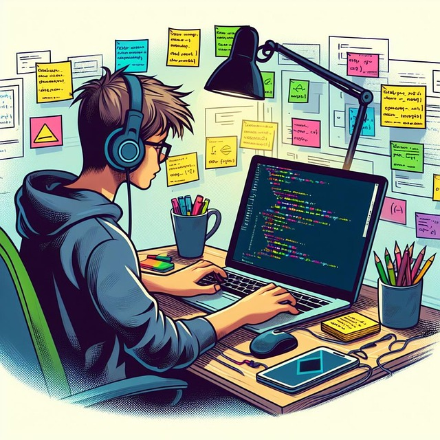
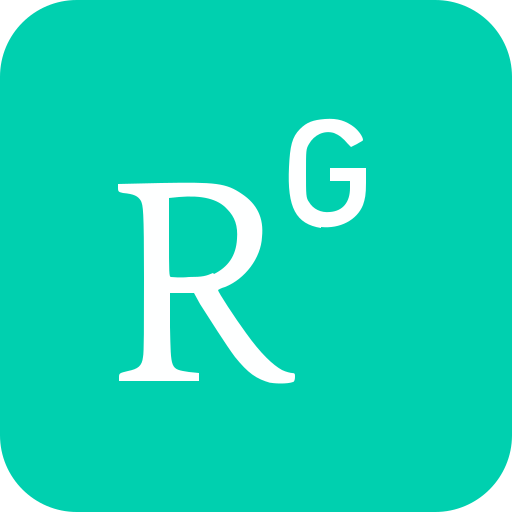
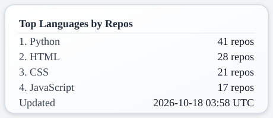
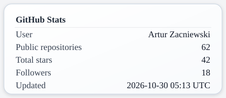
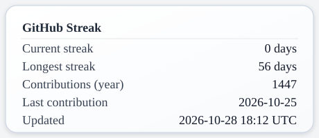

<div align="center">
  
  <h1>Hi, I'm Artur – developer and educator from Poland</h1>
</div>

<br/>

<div align="center">
  <table border="0" cellspacing="0" cellpadding="0">
    <tr>
      <td width="300" align="center" valign="middle">
        
      </td>
      <td width="300" align="center" valign="middle">
        <h3>Connect with me:</h3>
        <p>
          <a href="https://linkedin.com/in/artur-zacniewski-29436928" target="_blank">
            
          </a>
          &nbsp;&nbsp;
          <a href="https://www.researchgate.net/profile/Artur_Zacniewski" target="_blank">
            
          </a>
          &nbsp;&nbsp;
          <a href="https://www.kaggle.com/zacniewski" target="_blank">
            
          </a>
        </p>
      </td>
    </tr>
  </table>
</div>


----  


<h3 align="center">🛠️ Tech Stack</h3>

<p align="center">
  
  
  
  
  
  
  
  
  
</p>

<br/>

<h3 align="center">📊 Statistics</h3>

<p align="center">
  
  
</p>
<p align="center">
  
</p>

----

<h3 align="center">📊 Recently used languages</h3>


<!--START_SECTION:waka-->

```txt
From: 14 February 2026 - To: 30 October 2026

Total Time: 232 hrs 16 mins

Markdown                   96 hrs 44 mins        ██████████▒░░░░░░░░░░░░░░   41.63 %
Python                     54 hrs                █████▓░░░░░░░░░░░░░░░░░░░   23.23 %
HTML                       22 hrs 54 mins        ██▒░░░░░░░░░░░░░░░░░░░░░░   09.86 %
YAML                       11 hrs 20 mins        █▒░░░░░░░░░░░░░░░░░░░░░░░   04.88 %
GitIgnore file             7 hrs 36 mins         ▓░░░░░░░░░░░░░░░░░░░░░░░░   03.28 %
Text                       6 hrs 47 mins         ▓░░░░░░░░░░░░░░░░░░░░░░░░   02.92 %
Java                       6 hrs 13 mins         ▓░░░░░░░░░░░░░░░░░░░░░░░░   02.68 %
Bash                       4 hrs 54 mins         ▓░░░░░░░░░░░░░░░░░░░░░░░░   02.11 %
Docker                     4 hrs                 ▒░░░░░░░░░░░░░░░░░░░░░░░░   01.73 %
SQL                        3 hrs 47 mins         ▒░░░░░░░░░░░░░░░░░░░░░░░░   01.63 %
TOML                       3 hrs 43 mins         ▒░░░░░░░░░░░░░░░░░░░░░░░░   01.60 %
JSON                       3 hrs 12 mins         ▒░░░░░░░░░░░░░░░░░░░░░░░░   01.38 %
JavaScript                 1 hr 38 mins          ▒░░░░░░░░░░░░░░░░░░░░░░░░   00.71 %
.env file                  1 hr 7 mins           ░░░░░░░░░░░░░░░░░░░░░░░░░   00.48 %
Requirements.txt           1 hr 4 mins           ░░░░░░░░░░░░░░░░░░░░░░░░░   00.46 %
```

<!--END_SECTION:waka-->
